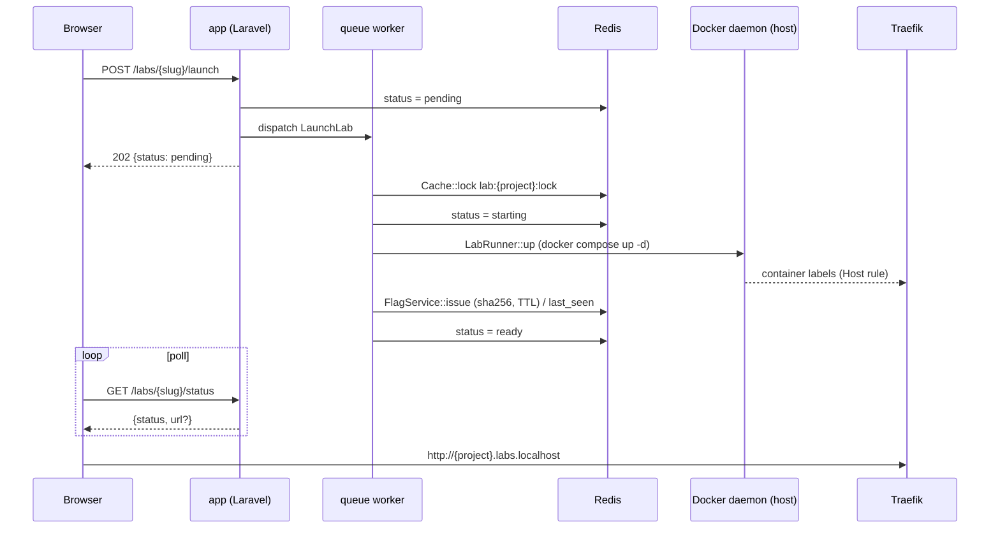

# Architecture

Contracts live in [`../CLAUDE.md`](../CLAUDE.md); this file explains how the pieces fit. Each track extends its own section.

## Components

| Component | Role |
|---|---|
| `nginx` | Serves the platform on `127.0.0.1:8080`, forwards PHP to `app:9000`. |
| `app` | php-fpm 8.5 with the Docker CLI and compose plugin; `/var/run/docker.sock` mounted. |
| `queue` | Same image; `php artisan queue:work`. Runs `LaunchLab` / `StopLab`, which call `LabRunner`. |
| `scheduler` | Same image; `php artisan schedule:work`. Runs `labs:reap` every minute. |
| `mysql` | MySQL 8.0. Databases `appsec` (dev) and `testing` (PHPUnit). Not published to the host. |
| `redis` | Cache, queue, locks, throttle, instance status. Not published to the host. |
| `traefik` | v3, Docker provider, `exposedByDefault=false`, watches network `labs_proxy`. Published on `127.0.0.1:80` for `*.labs.localhost`. |
| Lab instances | Compose projects started from `labs/{slug}/docker/docker-compose.yml`. No host ports; the entry service joins `labs_proxy` and carries Traefik labels. |

Networks: `default` (platform) and `labs_proxy` (fixed name, created by the platform compose file; lab compose files join it as `external`).

## Request flow

Browser -> `127.0.0.1:8080` -> nginx -> php-fpm (Laravel, `web` middleware: session, CSRF) -> controller -> models / services. Auth is Google OAuth via Socialite and the session guard (sessions in MySQL). Unauthenticated users are redirected to `home`. Lab pages are reached at `http://{project}.labs.localhost` through Traefik.

## Lab launch sequence (planned, Runtime track)

## Trust boundary

- Mounting `/var/run/docker.sock` into `app`, `queue` and `scheduler` is equivalent to root on the host. Anyone who achieves code execution in those containers owns the host. See [ADR 0002](decisions/0002-docker-socket-trust-boundary.md).
- Traefik gets the socket read-only (it only lists containers and reads labels).
- Lab containers never receive the socket (defect D10: the old `stopper` container is gone).
- The labs are intentionally vulnerable. All published ports bind to `127.0.0.1`; MySQL and Redis are not published. Do not expose this stack on a network.

## Host-path mount rule

`docker compose` runs inside `app`/`queue`, but bind mounts in lab compose files (for example `../:/labs/osci`) are resolved by the host daemon against host paths. The project directory is therefore mounted at the identical absolute path inside the containers (`HOST_PROJECT_PATH`, default `${PWD}`), and the working directory is that path. `labs/` and `storage/app/instances/` resolve identically for both sides. See [ADR 0001](decisions/0001-host-path-bind-mounts.md).

## Data model

`users`, `labs`, `lab_user` (progress, one row per user and lab), `flag_attempts`, `admin_actions`. Schema in `CLAUDE.md`; migrations in `database/migrations`. Redis holds no durable data.

## Track sections

### Auth
_To be written by the Auth track._

### Catalog and hints
_To be written by the Catalog track._

### Runtime and flag
_To be written by the Runtime track (LabRunner, InstanceResolver, FlagService, jobs, reaper)._

### Admin
_To be written by the Admin track._
