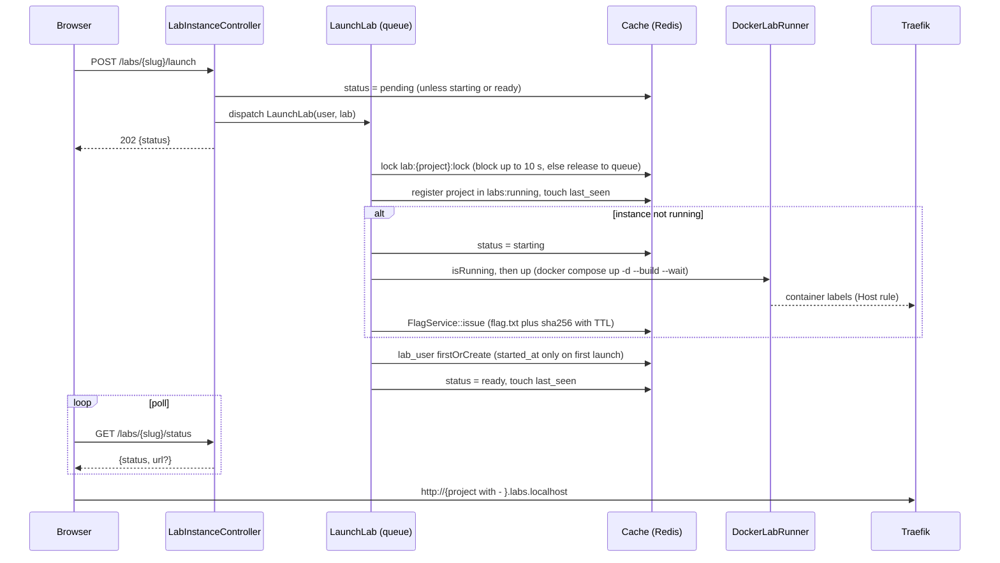

# Architecture

Contracts live in [`../CLAUDE.md`](../CLAUDE.md); this file explains how the pieces fit. Each track extends its own section.

## Components

| Component | Role |
|---|---|
| `nginx` | Serves the platform on `127.0.0.1:8080`, forwards PHP to `app:9000`. |
| `app` | php-fpm 8.5 with the Docker CLI and compose plugin; `/var/run/docker.sock` mounted. |
| `queue` | Same image; `php artisan queue:work`. Runs `LaunchLab` / `StopLab`, which call `LabRunner`. |
| `scheduler` | Same image; `php artisan schedule:work`. Runs `labs:reap` every minute. |
| `mysql` | MySQL 8.0. Databases `appsec` (dev) and `testing` (PHPUnit). Not published to the host. |
| `redis` | Cache, queue, locks, throttle, instance status. Not published to the host. |
| `traefik` | v3, Docker provider, `exposedByDefault=false`, watches network `labs_proxy`. Published on `127.0.0.1:80` for `*.labs.localhost`. |
| Lab instances | Compose projects started from `labs/{slug}/docker/docker-compose.yml`. No host ports; the entry service joins `labs_proxy` and carries Traefik labels. |

Networks: `default` (platform) and `labs_proxy` (fixed name, created by the platform compose file; lab compose files join it as `external`).

## Request flow

Browser -> `127.0.0.1:8080` -> nginx -> php-fpm (Laravel, `web` middleware: session, CSRF) -> controller -> models / services. Auth is Google OAuth via Socialite and the session guard (sessions in MySQL). Unauthenticated users are redirected to `home`. Lab pages are reached at `http://{project}.labs.localhost` through Traefik.

## Lab launch sequence

See [Runtime and flag](#runtime-and-flag) for the diagram, which matches `LabInstanceController`, `LaunchLab` and `DockerLabRunner`.

## Trust boundary

- Mounting `/var/run/docker.sock` into `app`, `queue` and `scheduler` is equivalent to root on the host. Anyone who achieves code execution in those containers owns the host. See [ADR 0002](decisions/0002-docker-socket-trust-boundary.md).
- Traefik gets the socket read-only (it only lists containers and reads labels).
- Network isolation: the lab network `labs_proxy` never contains a platform service except Traefik. `app`, `queue`, `scheduler`, `mysql`, `redis` and `nginx` are on `default` only, so a shell inside a lab (for example `osci`) cannot reach php-fpm on `app:9000`, which would mean code execution next to the Docker socket.
- Lab containers never receive the socket (defect D10: the old `stopper` container is gone).
- The labs are intentionally vulnerable. All published ports bind to `127.0.0.1`; MySQL and Redis are not published. Do not expose this stack on a network.

## Host-path mount rule

`docker compose` runs inside `app`/`queue`, but bind mounts in lab compose files (for example `../:/labs/osci`) are resolved by the host daemon against host paths. The project directory is therefore mounted at the identical absolute path inside the containers (`HOST_PROJECT_PATH`, default `${PWD}`), and the working directory is that path. `labs/` and `storage/app/instances/` resolve identically for both sides. See [ADR 0001](decisions/0001-host-path-bind-mounts.md).

## Data model

`users`, `labs`, `lab_user` (progress, one row per user and lab), `flag_attempts`, `admin_actions`. Schema in `CLAUDE.md`; migrations in `database/migrations`. Redis holds no durable data.

## Track sections

### Auth
Flow: `GET /login` (guest) sends the browser to Google through Socialite (scopes `email`, `profile`). Google returns to `GET /auth/google/callback`, which upserts the user by `google_id`, logs in, regenerates the session and redirects to `labs.index`. `POST /logout` logs out, invalidates the session, regenerates the CSRF token and redirects to `home`. Controller: `App\Http\Controllers\Auth\GoogleController`. Admins are made with `user:promote {email}` / `user:demote {email}` (exit 1 for an unknown email).

| Defect | Fix |
|---|---|
| D5 (unprotected routes) | `guest`/`auth`/`can:admin` route middleware in `routes/web.php`; guests are redirected to `home` (covered by `AuthTest`). |
| D6 (callback overwrote role) | The callback writes only `google_id`, `email`, `name`, `last_login_at`. `role` is not fillable and never assigned there; new users get the DB default `user`, existing admins keep their role. Only the artisan commands assign `role`. |
| D7 (OAuth errors reached the user) | Every `Throwable` from Socialite (`InvalidStateException`, Guzzle `ClientException`, missing `code`, ...) is reported and turned into a redirect to `home` with flash `error`. |
| D13 (logout without CSRF) | Logout is a `POST` in the `web` group, so CSRF verification applies (419 without token); the session is invalidated and the token regenerated. |

Unverified email: the callback refuses (redirect `home` with `error`, nothing written) unless Google's raw `email_verified` is strictly boolean `true`. Otherwise someone could register a Google account on another person's address, sign in first and squat it, and `user:promote <email>` would then promote the attacker.

Edge case: a known email arriving with a different `google_id` (recycled or second Google account). The callback refuses the login (redirect to `home` with `error`) and writes nothing. Linking by email would let whoever controls that address take over the account, including an admin, and inserting would violate the unique `email` index. An admin has to resolve it manually.

### Catalog and hints
_To be written by the Catalog track._

### Runtime and flag
Docker is reached only through `App\Contracts\LabRunner` (`DockerLabRunner`: Symfony Process, argument arrays, slug must exist in `labs`). `InstanceResolver::project()` names the instance (`lab_{slug with - as _}` in phase 3); every cache key below is keyed by that project name.

**Cache keys** (all via the `Cache` facade, no Redis-only commands):

| Key | Value | TTL |
|---|---|---|
| `lab:{project}:status` | `pending`, `starting`, `ready`, `stopped`, `failed`; a missing key reads as `stopped` | none |
| `lab:{project}:flag` | sha256 of the flag | `labs.max_minutes` |
| `lab:{project}:last_seen` | unix timestamp | none |
| `lab:{project}:lock` | atomic lock | 120 s |
| `labs:running` | map `project => slug` (the reaper needs the slug, which cannot be derived from the name), written under the 10 s lock `labs:running:lock` | none |

**Flag.** `FlagService::issue` writes a random 32-byte hex flag to the instance flag file (phase 3: `labs/{slug}/flag.txt`, directory created if missing) and stores only its sha256 in cache. `verify` compares with `hash_equals`; no stored hash, an empty submission or an expired TTL all mean false. See [ADR 0004](decisions/0004-flag-in-redis.md). A correct submission updates only the submitting user's `lab_user` row (and only while it is `started`), records the attempt, then dispatches `StopLab`.

**Lock (D3).** `LaunchLab` and `StopLab` both run under `lab:{project}:lock`. A second launch waits up to 10 s, then finds the instance running and does not call `up`; if the lock is still held after 10 s the job releases itself back to the queue. Job timeout is 180 s, compose calls are killed after 150 s.

**Reaper (D10).** `labs:reap` runs every minute, walks `labs:running` and dispatches `StopLab(slug, project)` for each project whose `last_seen` is older than `labs.idle_minutes` (or missing). `StopLab` runs `down` (compose down `-v --remove-orphans`, then empties `labs/{slug}/docker/storage` and `labs/{slug}/storage`, keeping `.gitkeep`), forgets the flag hash, sets status `stopped` and removes the project from `labs:running`.

**Failure handling.** If `up` throws `LabRunnerException`, `LaunchLab` logs the error, sets status `failed`, issues no flag and creates no `lab_user` row (so the hint clock does not start). `LaunchLab` then runs a best-effort `down` (its own failure is only logged) so no partial stack survives; the project stays in `labs:running`, so the reaper retries if that `down` failed. When a launch finds the instance running but no flag hash in cache (TTL expired by repeated relaunches), it re-issues a fresh flag (`FlagService::isIssued`) before setting `ready`; an instance is never `ready` without a valid flag. A new launch retries (status goes `pending`, then `starting`). A lock timeout is not a failure: the job is released back to the queue. In phase 3 the instance is shared per lab, so one student's correct flag stops it for everyone on that lab; phase 6 removes this by changing only `InstanceResolver::project()`.

### Labs

**Compose file rules:** Each lab's `labs/{slug}/docker/docker-compose.yml` follows these constraints:

- **No stopper service** (defect D10): the old `stopper` service that mounted `/var/run/docker.sock` is removed entirely. Instance cleanup is handled by `labs:reap`.
- **No `container_name`:** services use their service name as the hostname. Phase 3 sets `COMPOSE_PROJECT_NAME` to `lab_{slug}` per lab; phase 6 will set it to `lab_{slug}_u{user_id}` per user.
- **No published host ports:** all services except the entry service have no `ports:` section. The entry service has no host-side port either; routing is entirely through Traefik.
- **Entry service on `labs_proxy`:** exactly one service (e.g. `nginx` for most labs, `app` for ssrf) joins both `default` (internal) and the external `labs_proxy` network. It carries Traefik labels with a Host rule using `${LAB_HOST}` (set by `LabRunner` to `lab_{project with - for _}.labs.localhost`).
- **Traefik labels:** the entry service advertises itself with labels keyed by `${COMPOSE_PROJECT_NAME}`:
  - `traefik.enable=true`
  - `traefik.docker.network=labs_proxy`
  - `traefik.http.routers.${COMPOSE_PROJECT_NAME}.rule=Host(\`${LAB_HOST}\`)`
  - `traefik.http.routers.${COMPOSE_PROJECT_NAME}.entrypoints=web`
  - `traefik.http.services.${COMPOSE_PROJECT_NAME}.loadbalancer.server.port={80 or 8080}`

**Network aliases:** when lab code references an old `container_name` (e.g. `http://ssrf_admin:9090`), the service is given an alias on its network instead of a fixed name. For example, the ssrf admin service has `networks: labnet: aliases: [ssrf_admin]`, allowing the app to reach it by the old name without editing lab code.

**Flag delivery:** each lab stores `flag.txt` at a known path inside its instance (either app root or a documented location within `labs/{slug}/`). The platform writes the plaintext flag to `labs/{slug}/flag.txt` on the host; bind mounts (`../:/labs/{slug}`) make it visible to containers. Lab code reads it via file operations or HTTP endpoints exposed by the same instance, and submits the flag through the platform's `/labs/{slug}/flag` endpoint.

### Admin
_To be written by the Admin track._
